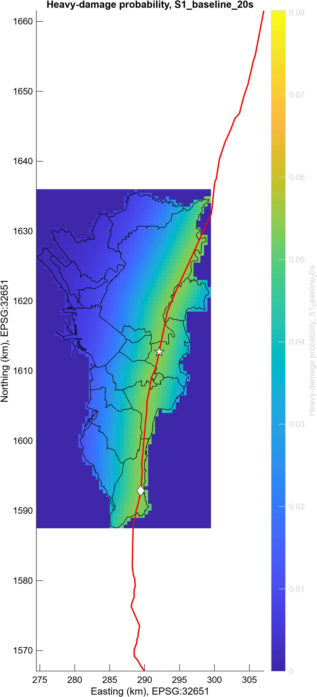
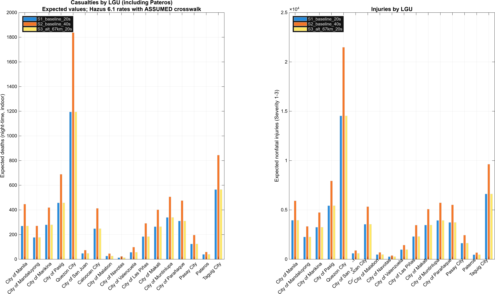
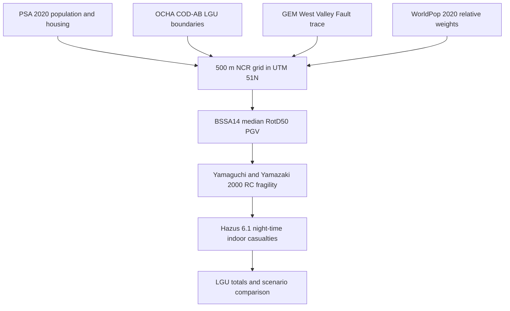

# Grid-Based Casualties Simulation Following The Big One

**CS0019 — Modeling & Simulation**  
Chan Reese, Ebrahim Fathi, Pacate Denienz, and Whitty Juan Angelo Roy

This repository is a MATLAB model of expected night-time indoor earthquake damage and casualties in Metro Manila (NCR) for a magnitude 7.2 West Valley Fault event — “The Big One.” PSA 2020 population and occupied housing are allocated to a 500 m grid with WorldPop weights. Ground motion is BSSA14 median RotD50 PGV along a 67 km rupture of the GEM West Valley Fault. Damage uses the Yamaguchi & Yamazaki (2000) RC-average fragility, and casualties use Hazus 6.1 night-time indoor rates. Three official scenarios are reported: **S1** (20 s, baseline epicenter in Pasig), **S2** (40 s, same rupture, assumed duration scaling), and **S3** (20 s, alternative epicenter in Muntinlupa). The figures below are model expectations from a verified `matlab -batch "run_all"` on base MATLAB R2026a, not observations.

## Key results

From [`results/scenarios/scenario_comparison.csv`](results/scenarios/scenario_comparison.csv). Every scenario uses the same exposure: **13,484,462** PSA 2020 residents and **3,257,020** occupied housing units. Casualties are **night-time indoor expected values** (2:00 a.m., indoor fraction 0.98901). They are means, not simulation draws. The model is deterministic (no random seed).

| Scenario | Role | Duration (s) | Heavily damaged units | Expected deaths | Expected injuries | Deaths per 1,000 |
|---|---|---:|---:|---:|---:|---:|
| S1 baseline | official | 20 | 91,069.4 | 4,598.6 | 57,470.9 | 0.3410 |
| S2 longer shaking | official, **assumed** duration (α = 0.25) | 40 | 140,421.1 | 7,094.8 | 84,709.2 | 0.5261 |
| S3 alternative epicenter | official | 20 | 91,068.6 | 4,598.6 | 57,470.4 | 0.3410 |
| S1p | illustrative point-source | 20 | 41,800.5 | 2,035.4 | 29,502.8 | 0.1509 |
| S3p | illustrative point-source | 20 | 13,701.2 | 701.3 | 14,385.4 | 0.0520 |

S2 deaths are **54.28%** above S1 because the assumed α = 0.25 raises PGV. That increase is a sensitivity, not a cited duration relation.

Official **S3 equals S1** in expected deaths (**0.00%** difference: 4,598.552 vs 4,598.592). A 67 km rupture covers the entire ~41 km NCR portion of the West Valley Fault in both epicenter positions, so Joyner–Boore distance barely changes. That is a finding, not a bug. The illustrative point-source pair is where a geographic shift is visible (S3p is much lower than S1p).

The highest S1 *rates* are along the fault (Taguig 0.638, Muntinlupa 0.624, Marikina 0.613, Pateros 0.607 deaths per 1,000), not always the largest totals (Quezon City 1,194.7, Taguig 565.4, Pasig 457.6). Pateros is included (39.6 expected deaths). Full LGU tables and the written report are in [`docs/REPORT.md`](docs/REPORT.md).





## Method



For each of the **2,645** active 500 m cells (100 crossed by the fault), the model takes Joyner–Boore distance to a 67 km subset of the GEM PHL_31 West Valley Fault, evaluates BSSA14 median PGV (\(M_w=7.2\), strike-slip, assumed \(V_{S30}=360\) m/s), applies the Yamaguchi & Yamazaki RC-average heavy / moderate-only / below-moderate curves, maps those states to Hazus Complete / Moderate / Slight with an **assumed** crosswalk, and multiplies by night-time indoor occupants in PSA occupied housing units. Official S1, S2 and S3 share exposure, vulnerability, magnitude and fault; they differ only by duration treatment (S2) or rupture centre (S3).

Grid construction, population allocation and distance fields are described in [`docs/ncr_grid_method.md`](docs/ncr_grid_method.md). Modelling choices that are not identified by the Kobe data are listed in [`docs/ASSUMPTIONS.md`](docs/ASSUMPTIONS.md).

## Data sources

Raw files that are too large, or whose licence forbids redistribution, are not in the repository. Processed extracts used by MATLAB are in `data/processed/`. Retrieval notes, hashes and vintage traps are in [`docs/data_sources.md`](docs/data_sources.md). To rebuild the extracts, see [`tools/README.md`](tools/README.md).

| Source | What is used | Licence / citation | In the repo? |
|---|---|---|---|
| [PSA 2020 CPH](https://openstat.psa.gov.ph/PXWeb/api/v1/en/DB/1A/PO_2020/0011A6DPHH0.px) (OpenSTAT `0011A6DPHH0`, `0041A6DTOB0`, `0051A6DBNF0`) | Population **13,484,462** and **3,257,020** occupied housing units for all 17 NCR LGUs, including Pateros | Philippine government statistics (RA 8293 §176). Cite “Philippine Statistics Authority, 2020 CPH”. | Yes: `data/raw/psa/` and processed LGU CSVs |
| [OCHA HDX COD-AB Philippines](https://data.humdata.org/dataset/cod-ab-phl) (NAMRIA + PSA, v03) | Admin-3 polygons for the 17 LGUs | **CC BY-IGO**. Attribute NAMRIA / PSA / OCHA. | Raw GDB not committed. Processed vertices and attributes are. |
| [GEM Global Active Faults](https://github.com/GEMScienceTools/gem-global-active-faults), West Valley Fault `PHL_31` | 108-vertex rupture trace (UTM length 98.582 km) | **CC BY-SA 4.0** | Raw GeoJSON not committed. Processed: `wvf_trace_vertices.csv` and its licence file. |
| [WorldPop Global2 R2025A](https://doi.org/10.5258/SOTON/WP00839), 2020 constrained 100 m | **Relative weights only.** LGU totals always come from PSA. | **CC BY 4.0**. WorldPop (University of Southampton and collaborators). | Raw GeoTIFF not committed. Processed pixel CSV is. |
| City of Kobe 1990 census and [Higai outcomes](https://www.city.kobe.lg.jp/a21572/bosai/shobo/hanshinawaji/higai2.html) | Nine-ward 1990-10-01 population 1,477,410; deaths 4,571; injuries 14,678 | City of Kobe published statistics | Yes: `data/processed/kobe_ward_*.csv` |
| [Yamaguchi & Yamazaki (2000)](https://www.iitk.ac.in/nicee/wcee/article/2451.pdf), 12WCEE 2451, Tables 3–4 | RC-average heavy λ = 5.71, ζ = 0.849 | Cite the paper | Yes: `data/processed/fragility_parameters.csv` |
| [BSSA14](https://doi.org/10.1193/070113EQS184M) (Boore, Stewart, Seyhan, Atkinson 2014) | Median RotD50 PGV (cm/s), coefficients as in OpenQuake `boore_2014.py` | Cite the paper | Yes: `data/processed/bssa14_coefficients.csv` |
| FEMA *Hazus 6.1 Earthquake Model Technical Manual* (July 2024), Section 12 | Indoor casualty and collapse-given-complete rates; night-time indoor fraction 0.98901 | Cite FEMA Hazus 6.1. Official PDF returned HTTP 403 here; the file was taken from an Internet Archive snapshot of the same manual. | Yes: `data/processed/hazus61_*.csv` |
| MMEIRS 2004 Model 08 (JICA / MMDA / PHIVOLCS) | \(M_w=7.2\), 67 km rupture length; published 33,500 deaths / 113,600 injuries used only as a **benchmark** | Cite the MMEIRS Final Report, Ch. 2 Table 2.1.2 | Not a model input. Comparison table: `results/scenarios/mmeirs_model08_benchmark.csv` |

This model’s official S1 rate is **0.341 deaths per 1,000** on the 2020 population, versus MMEIRS Model 08’s **3.37 per 1,000** on a 2000 population of 9,932,560. Inventory, year, ground-motion method, fragility and fire treatment all differ. The comparison is not a validation, and the model was not tuned to match 33,500 deaths.

## Repository layout

```text
ModSim_FinalProject/
├── config/modsim_config.json     # CRS, grid, scenarios, assumed parameters
├── data/
│   ├── processed/                # CSVs the MATLAB runners actually read
│   └── raw/psa/                  # PSA OpenSTAT extracts (large COD-AB, GEM and WorldPop raw files are gitignored)
├── docs/
│   ├── REPORT.md                 # methods, results, limitations
│   ├── ASSUMPTIONS.md            # labelled assumptions and transfers
│   ├── data_sources.md           # sources, licences, retrieval dates
│   ├── ncr_grid_method.md        # 500 m grid and dasymetric allocation
│   └── DEMO.md                   # how to run a live demonstration
├── results/
│   ├── all_checks.csv            # combined verification ledger
│   ├── kobe/                     # ward rates and Kobe checks
│   ├── ncr_grid/                 # base map, population, distance fields
│   └── scenarios/                # S1/S2/S3 maps, LGU charts, comparison tables
├── src/                          # UTM, geometry, BSSA14, fragility, I/O
├── tests/                        # unit tests called by run_unit_tests
├── tools/                        # optional Python rebuild of processed NCR inputs
├── run_all.m                     # full verified workflow
├── run_kobe.m
├── run_ncr_grid.m
├── run_scenarios.m
├── run_unit_tests.m
├── starter.m                     # RC heavy-damage curve (unchanged)
└── inspect_jma_kobe.m            # optional; JMA file is gitignored and not required
```

`docs/RESEARCH.md` is present from branch `step5to9` and was left untouched in this work.

## Requirements

- **MATLAB R2026a**, base MATLAB only. No toolboxes are required. The Mapping Toolbox is not used. The runners are written for base MATLAB R2020a or later (`readtable`, `polyshape`, `inpolygon`, `erfc`, `exportgraphics`).
- The processed CSVs already in `data/processed/`. You do not need the raw COD-AB FileGDB, WorldPop GeoTIFF, or GEM GeoJSON to run the model.
- Optional, only to rebuild those CSVs: Python 3 and the packages in [`tools/requirements-prep.txt`](tools/requirements-prep.txt). See [`tools/README.md`](tools/README.md).

## Quick start

From the repository root:

```text
matlab -batch "run_all"
```

If `matlab` is not on `PATH`:

```text
"C:\Program Files\MATLAB\R2026a\bin\matlab.exe" -batch "run_all"
```

`run_all` prints the MATLAB version and product list, runs unit tests, rebuilds the Kobe tables and NCR grid, evaluates official S1/S2/S3 plus illustrative S1p/S3p, writes figures and CSVs, and exits with an error if any required check fails. `SKIPPED` is not a failure. The first grid build takes a few minutes; figures are written with the display off, so a headless session is enough.

Unit tests only:

```text
matlab -batch "addpath('src'); addpath('tests'); run_unit_tests(load_modsim_config(pwd), init_checks())"
```

Outputs land under `results/`:

| Path | Contents |
|---|---|
| [`results/all_checks.csv`](results/all_checks.csv) | Combined checks from the last `run_all` |
| `results/kobe/` | Ward rate chart and Kobe checks |
| `results/ncr_grid/` | Base map, population and distance maps, cell tables |
| `results/scenarios/` | Scenario maps, LGU charts, `scenario_comparison.csv`, sensitivity and MMEIRS tables |

Details for a live demonstration are in [`docs/DEMO.md`](docs/DEMO.md).

## Verification

The last complete run is recorded in [`docs/REPORT.md`](docs/REPORT.md): `matlab -batch "run_all"` on MATLAB R2026a Update 5 (26.1.0.3346908), Windows 11, finished at 12:27 PM Asia/Singapore on 13 November 2026, exit code 0.

[`results/all_checks.csv`](results/all_checks.csv) reports **101 PASS, 0 FAIL, 1 SKIPPED**. The skipped check is **C18**: Mapping Toolbox not available; the base MATLAB path was used. That skip is expected. The authoritative path does not require the toolbox, so the same code can be run without it.

Unit tests cover the UTM 51N projection (max abs error \(4.93\times10^{-4}\) m, limit 0.05 m), a synthetic 3×3 fault-crossing grid, \(P_\mathrm{heavy}(100\,\mathrm{cm/s})=0.0965726316\), and BSSA14 PGV at \(R_{JB}=0\) and \(10\) km (77.1128 and 41.7464 cm/s). Grid checks include 17 LGUs, population conservation (13,484,462), Pateros (13 cells), and 100 fault-crossed cells. Scenario checks require non-negative finite casualties, LGU sums equal to cell sums, Pateros present, S2 deaths ≥ S1, and a visible difference between illustrative S1p and S3p.

## Assumptions and limitations

These are labelled in [`config/modsim_config.json`](config/modsim_config.json) and written out in [`docs/ASSUMPTIONS.md`](docs/ASSUMPTIONS.md) and the report. They are not calibrated NCR facts.

- **Duration α = 0.25** for S2 is assumed (`PGV_eff = PGV × (T/20)^α`). BSSA14 and Yamaguchi have no duration term.
- **\(V_{S30}=360\) m/s** is assumed for all of NCR (NEHRP C/D default). Sensitivity at 250 and 760 m/s is in `results/scenarios/vs30_sensitivity_S1.csv`. A rock site cuts mean heavy-damage probability from 0.029 to 0.008.
- **Japanese RC-average fragility** is an unvalidated transfer to Philippine occupied housing units. PSA units are not buildings, and there is no 2020 CPH wall-materials table on OpenSTAT, so every unit is treated as RC / C1*.
- The **Yamaguchi → Hazus damage-state crosswalk** is assumed.
- The Hazus 6.1 rates come from an **Internet Archive copy** of the July 2024 manual (the official FEMA URL returned HTTP 403 from the build environment).
- The rupture trace is **GEM GAF**, not the PHIVOLCS 1:5,000 Valley Fault System Atlas. Trace position has catalogue accuracy, not survey accuracy.
- **MMEIRS Model 08 is a benchmark, not a validation.**
- Epicenters are assumed points on the GEM trace, not a forecast.
- 2020 night-time residents only: no 2024 population, no daytime workplace redistribution, no visitors.
- Median / expectation only: no ground-motion residual, no fragility or fatality-rate uncertainty.
- Fire, liquefaction, tsunami, landslide and hospital-function loss are not modelled.
- A 1,000 m cell-size sensitivity is recorded in the config but was **not** run in this pass.

## Project checklist

- [x] Set up the repository and project folders.
- [x] Collect Kobe outcomes and the nine 1990 ward census workbooks.
- [x] Reproduce the published RC heavy-damage curve (`starter.m`).
- [x] Put population data in `data/processed/kobe_ward_population.csv` (1990-10-01 census, nine wards, 1,477,410). It had been misplaced in `fragility_parameters.csv`; that is now corrected and verified (checks K01–K06, K13–K14).
- [x] Remove duplicate total rows from the processed outcomes; retain nine ward records (deaths 4,571, injuries 14,678, full-damage 67,421, partial-damage 55,145, reporting dates kept distinct; K07–K11).
- [x] Save actual fragility coefficients under `data/processed/fragility_parameters.csv` (Yamaguchi & Yamazaki 2000 Tables 3–4; RC average heavy λ = 5.71, ζ = 0.849; \(P_\mathrm{heavy}(100\,\mathrm{cm/s})=0.0965726316\); K15–K19, F01–F06).
- [x] Complete `docs/data_sources.md` with sources, dates, units, and assumptions.
- [x] Join Kobe population and outcomes; verify totals and calculate descriptive rates (3.093928 deaths and 9.934954 injuries per 1,000 1990-census residents; these are event summaries, not NCR coefficients).
- [x] Collect matching NCR boundaries, population, West Valley Fault geometry, and building exposure (PSA 2020 CPH 13,484,462 across 17 LGUs including Pateros; COD-AB NAMRIA/PSA; GEM PHL_31; WorldPop weights; 3,257,020 occupied housing units).
- [x] Build the NCR grid and calculate epicenter/fault distances and fault crossings (500 m, origin (274500, 1587500), 2,645 active, 100 fault-crossed, 13 Pateros cells; C01–C16).
- [x] Select a supported cell-level ground-motion model and justify local building fragility choices (BSSA14 median RotD50 PGV; Yamaguchi RC average; both documented in `docs/ASSUMPTIONS.md` and `docs/data_sources.md`).
- [x] Implement damage and a separate casualty model with documented assumptions (Yamaguchi fragility, then Hazus 6.1 indoor rates with an assumed state crosswalk; night-time indoor 0.98901).
- [x] Compare baseline (20 s), longer shaking (40 s), and alternative epicenter (20 s). Official S1: 4,598.6 expected deaths, 57,470.9 injuries. Official S2 (assumed α = 0.25): 7,094.8 and 84,709.2. Official S3 (67 km rupture at the alternative centre): 4,598.6 and 57,470.4 — a 0.00% death difference from S1, because 67 km covers the NCR fault in both positions. Illustrative point-source S1p/S3p are also reported.
- [x] Verify bounds, totals, repeatability, and sensitivity to assumptions (`results/all_checks.csv`: 101 PASS, 0 FAIL, 1 SKIPPED; \(V_{S30}\) and duration-α tables in `results/scenarios/`). The model is deterministic (no RNG).
- [x] Generate damage maps, casualty charts by city/LGU, and scenario comparisons (`results/ncr_grid/`, `results/scenarios/`; Pateros is included).
- [x] Make `run_all.m` reproduce the workflow. `matlab -batch "run_all"` was run to completion on MATLAB R2026a with only base MATLAB installed. Simulink was not required and was not added.
- [x] Finish the report, limitations, and demonstration (`docs/REPORT.md`, `docs/DEMO.md`). A decision on `.cache/modsim-qa` is still needed with Yuan; that folder was left untouched.

## Team

CS0019 Modeling & Simulation, Final Project.

| Member |
|---|
| Chan Reese |
| Ebrahim Fathi |
| Pacate Denienz |
| Whitty Juan Angelo Roy |

Repository: [itsriffchan/ModSim_FinalProject](https://github.com/itsriffchan/ModSim_FinalProject).

## How to contribute

1. Create a feature branch. Do not commit directly to `main`.
2. Change only what the task needs. Do not invent figures or rewrite processed inputs by hand.
3. Do not add the gitignored raw trees (`data/raw/cod_ab/`, `data/raw/gem/`, `data/raw/worldpop/`, `data/raw/jma_kobe/`).
4. Leave `.cache/modsim-qa` and `docs/RESEARCH.md` alone unless the group decides otherwise with Yuan.
5. From the repository root, run `matlab -batch "run_all"` and confirm that required checks **PASS**. `SKIPPED` is not a failure. Include any updated files under `results/` that the run produced.
6. Open a pull request that states what changed and points to the relevant checks.

## License

No license file is present in this repository, so no licence is specified. Third-party data and coefficients keep their original licences (see [Data sources](#data-sources)). GEM-derived vertices are also accompanied by `data/processed/wvf_trace_vertices.LICENSE.txt`.

## Citation and acknowledgements

If you use this work, please cite the repository and the sources it depends on:

> Chan Reese, Ebrahim Fathi, Pacate Denienz, and Whitty Juan Angelo Roy. *Grid-Based Casualties Simulation Following The Big One*. CS0019 Modeling & Simulation, 2026. https://github.com/itsriffchan/ModSim_FinalProject

Population and housing: Philippine Statistics Authority, 2020 Census of Population and Housing. Boundaries: NAMRIA / PSA / OCHA COD-AB (CC BY-IGO). Fault trace: GEM Global Active Faults, catalog `PHL_31` (CC BY-SA 4.0). Population weights: WorldPop Global2 R2025A (CC BY 4.0, doi:10.5258/SOTON/WP00839). Ground motion: Boore, Stewart, Seyhan and Atkinson (2014), *Earthquake Spectra* 30(3). Fragility: Yamaguchi and Yamazaki (2000), 12WCEE paper 2451. Casualty rates: FEMA, *Hazus 6.1 Earthquake Model Technical Manual* (July 2024), Section 12. Scenario magnitude and rupture length, and the published benchmark totals, follow JICA / MMDA / PHIVOLCS, MMEIRS 2004, Final Report Chapter 2, Table 2.1.2, Model 08. Kobe reference counts follow the City of Kobe 1990 census extracts and published Higai outcome pages.
