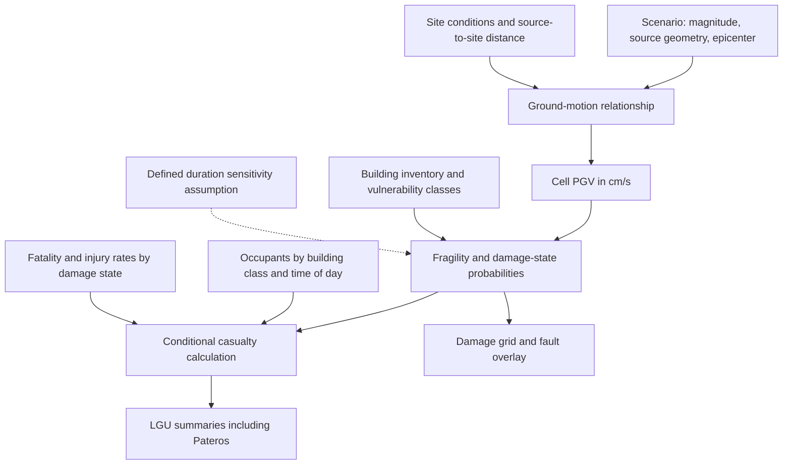

# Research basis for the NCR earthquake simulation

Evidence and repository review: 2026-11-11. This document separates historical observations, implemented behavior, proposed methods, and assumed sensitivity experiments. It supports a reproducible classroom simulation; illustrative outputs must carry their assumptions and must not be presented as earthquake forecasts.

## 1. Purpose and present implementation

The project will represent NCR as a simplified grid, estimate building damage and casualties, and aggregate fatalities and injuries by city/LGU, including Pateros. Required maps show color-coded damage, an assumed epicenter, and the West Valley Fault. The required comparisons are a 20-second baseline, 40 seconds at the same epicenter, and 20 seconds at an alternative epicenter. MATLAB is the intended engine; Simulink remains optional unless the course requires it. These are project requirements from [AGENTS.md](../AGENTS.md), rather than completed capabilities.

[starter.m](../starter.m) implements one published relationship: reinforced-concrete (RC), average-construction-period, heavy-damage probability conditional on peak ground velocity (PGV). It evaluates PGV from 0 through 180 cm/s, checks basic mathematical properties, and writes a curve and parameter table under [results](../results/). Its assumed example uses 1,000 buildings at 100 cm/s. It does not generate NCR shaking, allocate exposure, or estimate casualties. The opening comment mentions an older script name; the actual repository entry is `starter.m`.

The inspection found these unresolved items:

| Local evidence                                                        | Observed state and implication                                                                                                             |
| --------------------------------------------------------------------- | ------------------------------------------------------------------------------------------------------------------------------------------ |
| [Processed fragility file](../data/processed/fragility_parameters.csv) | Contains nine ward population records, despite its filename.                                                                               |
| [Population file](../data/processed/kobe_ward_population.csv)          | Empty; the README's checked population-placement item does not reflect the files.                                                          |
| [Outcome file](../data/processed/kobe_ward_outcomes.csv)               | Nine ward records plus two duplicate aggregate rows; totals contain Markdown emphasis inside numeric fields.                               |
| [Workflow entry](../run_all.m)                                         | Empty; no complete workflow can be reproduced through it yet.                                                                              |
| [JMA inspection script](../inspect_jma_kobe.m)                         | Expects `data/raw/jma_kobe/H1171931.csv`, which is absent. Its assumed sampling rate and units remain unverified against that recording. |
| [Source notes](data_sources.md)                                        | Document the selected fragility relationship but do not yet provide a complete acquisition and assumptions register.                       |

This research task leaves those files unchanged. Existing output files demonstrate stored results, not evidence that MATLAB ran during this review.

## 2. Concepts and model flow

An earthquake loss model connects several different quantities. The earthquake source and local conditions determine shaking; a vulnerability relationship translates shaking into building damage probabilities; occupancy and conditional casualty relationships connect damage to people harmed. Each connection needs its own inputs and evidence.

The dotted connection is a proposed extension. Duration currently has no computational path into the implemented fragility equation.

### Working glossary

| Term                                | Meaning and project use                                                                                             |
| ----------------------------------- | ------------------------------------------------------------------------------------------------------------------- |
| Magnitude                           | A measure of earthquake size. Record the scale, such as moment magnitude, rather than mixing magnitude conventions. |
| Shaking intensity                   | Local shaking severity or effects; an intensity scale is distinct from source magnitude.                            |
| PGA                                 | Peak ground acceleration; report acceleration units, such as cm/s² or g.                                           |
| PGV                                 | Peak ground velocity; the implemented fragility curve requires cm/s.                                                |
| Duration                            | A time interval defined by a stated criterion; it is separate from a peak amplitude.                                |
| Epicenter / hypocenter              | Surface point above the rupture's initiation point / the initiation point at depth.                                 |
| Population / occupants              | Census residents / people present in a modeled location at the scenario time.                                       |
| Household / housing unit / building | A social living arrangement / residential accommodation / a physical structure. They are different counting units.  |
| Fragility                           | Conditional probability of reaching or exceeding a specified damage threshold at a given shaking level.             |
| Exposure / vulnerability            | People or assets potentially affected / their susceptibility under specified conditions.                            |
| Expected loss                       | Probability-weighted mean loss; it may be fractional even when observed losses are whole counts.                    |
| LGU / inactive cell                 | Local government unit / grid location excluded from the modeled domain, distinct from zero damage.                  |

For example, multiplying a heavy-damage probability by a building count estimates an expected number of heavily damaged buildings under the selected model. Multiplying it directly by residents does not supply the missing probability that an occupant is killed or injured.

## 3. What Kobe contributes

The 1995 Hanshin-Awaji/Kobe earthquake supplies historical observations and published relationships to examine. [Project guidance](../AGENTS.md) motivates the analogue through similar strike-slip mechanisms. That similarity does not establish equal shaking, construction quality, occupancy, or emergency response in NCR. Kobe evidence should guide model structure and expose assumptions; Philippine inputs must describe the Philippine study area.

The local population records identify the census date as **1990-10-01**. Their nine wards sum to **1,477,410 people**, with male plus female population matching the total in each record. The Statistics Bureau's administrative reference table independently lists the same city total and ward values for 1990; its note states that census counts refer to October 1. Thus this denominator precedes the **1995-01-17** earthquake. It does not count the people actually present during shaking. [Statistics Bureau, administrative reference table](https://www.stat.go.jp/data/mesh/h12_j.htm).

The records identify the supplied workbooks and `D5:G5` source ranges. [Project guidance](../AGENTS.md) specifies D5 households, E5 population, F5 males, and G5 females. A future extraction should read those whole-ward cells and compare them with the processed records, avoiding the double counting that would follow from adding subdivision rows to ward totals. This review checked the CSV records and published reference table; it did not re-extract the XLS workbooks.

Kobe City's ward tables provide these controls:

| Reported outcome     |  Kobe City total | Reporting date |
| -------------------- | ---------------: | -------------- |
| Deaths               |     4,571 people | 2005-12-22     |
| Injuries             |    14,678 people | 2000-01-11     |
| Full damage, 全壊    | 67,421 buildings | 1995-12-22     |
| Partial damage, 半壊 | 55,145 buildings | 1995-12-22     |

The nine local outcome rows reproduce all four totals after excluding both aggregate rows. Preserve the Japanese category labels and reporting dates in cleaned metadata. The city page also reports fire damage separately; its totals must not be treated automatically as direct shaking-only losses or added across categories without checking overlap. [City of Kobe, human and building damage tables](https://www.city.kobe.lg.jp/a21572/bosai/shobo/hanshinawaji/higai2.html).

Calculated descriptions are approximately **3.093928 reported deaths** and **9.934954 reported injuries per 1,000 residents counted in 1990**. These divide the reported controls by 1,477,410 and multiply by 1,000. They summarize an event against an earlier census denominator. Neither is a conditional casualty coefficient for an NCR building damage state.

## 4. From source to ground motion

Distance alone does not specify PGV. A source scenario also needs magnitude, fault mechanism and rupture geometry; local site conditions require separate treatment. The team must distinguish a mapped surface fault trace from the finite fault area assumed to rupture.

A useful first experiment is a transparent, explicitly synthetic PGV field. For example, assume

\[
v_i=v_{\mathrm{ref}}\frac{r_{\mathrm{ref}}+r_0}{r_i+r_0},
\]

where velocities are in cm/s, all distances are in km, and \(r_0>0\) prevents a singularity. Choose and record the reference velocity and distances as teaching assumptions. This proposed equation tests geometry and plumbing; it has no fitted Philippine attenuation coefficients or demonstrated predictive accuracy. It also omits magnitude scaling and site response. A smooth map from it must retain the synthetic label.

A published alternative is **Boore, Stewart, Seyhan, and Atkinson (2014)**, which predicts PGA, PGV and spectral acceleration for shallow crustal earthquakes. Its Equation (1) separates source, path and site contributions to logarithmic ground motion. Main predictors include moment magnitude, fault type, \(V_{S30}\), and **\(R_{JB}\)**, the closest horizontal distance to the surface projection of the fault plane. \(V_{S30}\) represents shear-wave velocity averaged over the upper 30 m. Regional and basin-related choices also require review. [Boore et al., pp. 1061 and 1064](https://daveboore.com/pubs_online/ngaw2_paper_bssa14_eqs_2014.pdf).

Epicentral distance measures separation from one surface point. \(R_{JB}\) measures separation from a projected rupture area, while \(R_{rup}\) is the shortest three-dimensional distance to the rupture surface. These quantities are not interchangeable. In particular, describing the Boore model as requiring \(R_{rup}\) would select the wrong input. A trace-distance approximation needs an explicit geometric justification.

Boore et al. use **RotD50**, a horizontal component measure defined across orientations. Before connecting its PGV to the Japanese fragility curve, verify component compatibility, output units, magnitude/distance/site applicability, and the defensibility of regional settings for NCR. Matching cm/s alone does not establish compatibility. Adopt this as a candidate for assessment, not as an already validated Philippine model. [Boore et al., ground-motion intensity measures and predictor variables](https://daveboore.com/pubs_online/ngaw2_paper_bssa14_eqs_2014.pdf).

## 5. From PGV to building damage

The implemented curve comes from **Yamaguchi and Yamazaki (2000)**, 12WCEE paper 2451: Equation (1), printed page 4, and Table 3, printed page 5. Select the PGV columns for **RC, average construction period, heavy damage**:

\[
P_H(v)=\Phi\!\left(\frac{\ln v-5.71}{0.849}\right),\qquad v>0,
\]

with \(P_H(0)=0\). Here \(v\) is the numerical PGV in **cm/s**, \(\ln\) is the natural logarithm, and \(\Phi\) is the standard normal cumulative distribution. The lognormal parameters are \(\lambda=5.71\), controlling location, and \(\zeta=0.849\), controlling dispersion in logarithmic velocity. Preserve units with the coefficients. [Yamaguchi and Yamazaki, Equation (1) and Table 3](https://www.iitk.ac.in/nicee/wcee/article/2451.pdf).

The source survey covers **Nishinomiya City**, in the Kobe earthquake region. It classifies damage for property-tax reduction and distinguishes structural types and construction periods. Its average-period RC group reflects that Japanese inventory mix. The coefficients were not fitted from the project's nine Kobe ward totals and have not been validated for a Philippine inventory. Heavy damage is a survey threshold; equating it with physical collapse would require additional evidence. [Yamaguchi and Yamazaki, pp. 1–2](https://www.iitk.ac.in/nicee/wcee/article/2451.pdf).

An independent Python calculation gives

\[
P_H(100)=0.09657263158131965\approx0.0965726.
\]

For the script's hypothetical 1,000 comparable buildings under identical PGV, the expectation is approximately 96.5726 heavily damaged buildings. This calculation says nothing by itself about deaths. At \(v=\exp(5.71)\), the standardized argument is zero and probability is exactly 0.5 mathematically. The median velocity is approximately 301.8711 cm/s, outside the script's plotted interval; that mathematical check does not justify extrapolation to such shaking.

Table 4 instead describes **heavy plus moderate** damage. It overlaps Table 3. If compatible cumulative probabilities \(p_{M+}\) and \(p_H\) are used, mutually exclusive categories follow by subtraction:

\[
p_{\mathrm{moderate\ only}}=p_{M+}-p_H,\qquad
p_{\mathrm{below\ moderate}}=1-p_{M+}.
\]

Check \(0\leq p_H\leq p_{M+}\leq1\) throughout the adopted range before using this extension. These identities are probability bookkeeping; only the heavy curve is currently implemented. [Yamaguchi and Yamazaki, Tables 3–4](https://www.iitk.ac.in/nicee/wcee/article/2451.pdf).

## 6. From damaged buildings to casualties

Casualty estimation requires occupants and a conditional consequence model. FEMA's **Hazus 6.1 Earthquake Model Technical Manual**, Section 12, provides a methodological reference: population distribution and scenario time combine with building damage states and casualty rates. Its event trees distinguish collapse from non-collapse damage, and Table 12-1 separates injury severities from fatal or mortal injuries. The module's scope addresses casualties from building and bridge damage and excludes several other causes, including fire. [FEMA, Section 12, especially pp. 12-1–12-3 and 12-7–12-10](https://www.fema.gov/sites/default/files/documents/fema_hazus-earthquake-model-technical-manual-6-1.pdf).

A proposed simplified expectation is

\[
\mathbb E[F_i]=\sum_b O_{ib}\sum_d p_{ibd}f_{bd},\qquad
\mathbb E[I_i]=\sum_b O_{ib}\sum_d p_{ibd}q_{bd},
\]

where \(O_{ib}\) is occupants in cell \(i\), building class \(b\); \(p_{ibd}\) is a mutually exclusive damage-state probability; and \(f_{bd}\), \(q_{bd}\) are fatality and nonfatal-injury probabilities conditional on class and state. This is a proposed project formulation, not a verbatim Hazus equation or an implemented function. Its units are people times dimensionless probabilities, yielding expected people.

Specify occupancy by time of day, distinguish resident counts from people at work or school, and avoid counting one occupant in several exposure groups. Within the chosen casualty classification, death and nonfatal injury probabilities must not exceed one in combination. Add other causes only through separately documented models with overlap controls.

Hazus uses slight, moderate, extensive and complete structural damage, including a collapse subset of complete damage. The project's single Japanese heavy threshold cannot populate those states without a justified crosswalk and further relationships. [FEMA, p. 12-3 and Tables 12-6–12-8](https://www.fema.gov/sites/default/files/documents/fema_hazus-earthquake-model-technical-manual-6-1.pdf). If only two project states are retained, label the simplified conditional rates as assumptions and explore their sensitivity. Do not invent local coefficients or claim that adopting the event-tree structure validates imported rates.

## 7. Duration and alternative epicenters

Define what **20 seconds** means before comparing it with 40 seconds. Rupture duration concerns fault slip and propagation. Record length is the stored observation window. Significant shaking duration uses an explicit measure of the strong-motion interval, for example specified bounds on cumulative squared acceleration. These definitions can produce different intervals. USGS distinguishes rupture time from shaking duration at a location and stresses that shaking duration requires a criterion. [USGS duration guidance](https://www.usgs.gov/faqs/what-was-duration-earthquake-why-dont-you-report-duration-each-earthquake-how-does-duration?items_per_page=6&page=0&qt-news_science_products=0).

The implemented \(P_H(v)\) has no duration argument. Holding PGV fixed while changing the duration label yields identical modeled damage. Doubling losses would introduce an unsupported assumption. Recommended reporting is either an unchanged-result control, or a clearly labeled duration sensitivity extension with a declared formula and parameter range. A single historical event cannot identify that duration effect. A supported duration-dependent vulnerability relationship would be needed to interpret it as more than an assumed experiment.

Moving the epicenter also needs a computational definition. If magnitude, mechanism, site inputs and the entire rupture area stay fixed, a model depending on \(R_{JB}\) can give unchanged shaking even when the initiation point moves. Changing only the marker on a map cannot establish different losses. Options are a disclosed illustrative point-source comparison or an additional supported treatment of rupture propagation/directivity. If changing the rupturing segment is necessary, identify that as a separate source-geometry change; keep the underlying mapped fault network fixed.

Across comparisons, hold exposure, vulnerability, occupancy, fault data and unrelated settings constant. Save seeds if randomness is introduced. Document which assumption actually produces each scenario difference.

## 8. NCR data and spatial representation

The following is an acquisition roadmap, not a claim that the inputs have been downloaded. No matching NCR datasets were found among the inspected repository inputs.

| Input                          | Primary source or acquisition route                                                                                                               | Gap and conditions to record                                                                                                                                                            |
| ------------------------------ | ------------------------------------------------------------------------------------------------------------------------------------------------- | --------------------------------------------------------------------------------------------------------------------------------------------------------------------------------------- |
| Population                     | [PSA 2024 NCR population release](https://psa.gov.ph/content/highlights-national-capital-region-ncr-population-2024-census-population-2024-popcen) | Candidate census vintage; acquire exact LGU/barangay counts and definitions. Preserve reference date and reuse notice.                                                                  |
| Boundaries and geographic keys | [PSA PSGC](https://psa.gov.ph/classification/psgc), plus authoritative boundary metadata through [Geoportal Philippines](https://geoportal.gov.ph/) | Codes are join keys, not polygon geometry. Select compatible boundary and population vintages; resolve historical changes. Check each layer's access and redistribution terms.          |
| West Valley Fault geometry     | [PHIVOLCS FaultFinder](https://www.phivolcs.dost.gov.ph/information-tools/the-phivolcs-faultfinder/) and an authorized PHIVOLCS geometry product   | FaultFinder documents proximity queries and mapping metadata. Obtain usable geometry with permission, scale and mapping date; a displayed map is not blanket redistribution permission. |
| Building exposure              | Request compatible PSA housing information and LGU/engineering inventories                                                                        | Building counts, structure, height, age and use remain missing. Housing units cannot silently substitute for buildings. Record coverage and confidentiality restrictions.               |
| Occupancy                      | Census households plus defensible local time-of-day information                                                                                   | People per building class and daytime redistribution are unresolved; document assumptions and access conditions.                                                                        |
| Site conditions                | Authoritative local geotechnical/PHIVOLCS information, subject to availability                                                                    | A consistent site classification or \(V_{S30}\) layer remains missing. Document proxies, resolution, source methods and licensing.                                                      |

PSA identifies Pateros as NCR's municipality; retain it explicitly in the LGU join and output checks. [PSA NCR release](https://psa.gov.ph/content/highlights-national-capital-region-ncr-population-2024-census-population-2024-popcen). For every acquired input, record source URL/file, access and reference dates, reporting date, coverage, units, transformations and redistribution conditions. Public visibility alone does not settle permission to commit a dataset.

For a first spatial implementation, choose one suitable projected coordinate system after checking input datums, and express distances in km. Allocate each LGU's population to intersecting cells using weights that sum to one within that LGU. Area weighting is a transparent starting assumption; it assumes uniform density within its source zone. Building-informed allocation needs supporting data. Retain cell–LGU intersection records so small areas and boundary cells, including Pateros, conserve population.

Compute shortest distance to fault line segments, rather than only to vertices. Flag fault crossings by actual cell–line intersection; a far cell center can still belong to a crossed cell. Keep this flag distinct from a shaking or surface-rupture damage model. Use an explicit inactive-cell mask, north-up orientation, equal axis scaling, and identical damage color limits across scenarios. Legends should identify whether color means probability, building count, or another quantity.

## 9. Development sequence and verification

Recommended implementation order:

1. Reconcile the Kobe tables, remove aggregate rows from observation tables, and place population and fragility parameters in their intended files. Preserve raw downloads and record transformations.
2. Build a small synthetic grid with known cell/LGU memberships and a simple fault line. Exercise distances, intersections, allocation and aggregation before introducing NCR data.
3. Select the ground-motion relationship and document its units, component, geometry and applicability. Establish an explicit interface between shaking and fragility.
4. Define building classes, occupancy and casualty assumptions. Keep unsupported inputs visible and configurable; assess alternatives before producing loss totals.
5. Scale to compatible NCR geography and exposure. Save input versions, configuration, scenario definitions and provenance with generated results.
6. Compare the controlled scenarios, including unchanged-result controls where appropriate. Make `run_all.m` reproduce the MATLAB workflow before adding optional Simulink.

Verification checks whether implementation follows the specified equations: bounds, zero-input behavior, monotonicity over the adopted range, unique joins, missing-key detection, conservation of population, LGU-to-NCR reconciliation and repeatability. Missing inputs must raise a visible gap rather than become zeros. If Simulink is added, its final results must agree with MATLAB for identical inputs; repeatedly summing cumulative casualty estimates over time would overcount losses.

Calibration estimates parameters using observations. Independent validation compares predictions with compatible observations withheld from model fitting. Reproducing fitted Kobe damage demonstrates neither independent validation nor transfer validity in NCR. Sensitivity analysis varies declared assumptions; uncertainty analysis describes plausible variation and its sources. Keep uncertainty in ground motion separate from fragility dispersion and uncertainty in inventory or casualty rates, to avoid counting the same variability twice.

### Checks completed for this document

Python checked nine unique population keys, sex-total consistency, nine matched outcome wards, all four outcome controls, zero-PGV behavior, the 100 cm/s probability, and the median identity. It compared all **181 stored curve rows** with an independent calculation: probabilities were bounded and nondecreasing, with maximum absolute difference below **6 × 10⁻¹⁶**. These are arithmetic and stored-output checks. **MATLAB was not executed**, the missing JMA record was not analyzed, and no NCR simulation or independent loss validation was completed.

## Linked references

- [Yamaguchi, N., and Yamazaki, F. (2000). *Fragility Curves for Buildings in Japan Based on Damage Surveys after the 1995 Kobe Earthquake*, 12WCEE paper 2451](https://www.iitk.ac.in/nicee/wcee/article/2451.pdf). Equation (1), p. 4; Tables 3–4, p. 5.
- [Statistics Bureau of Japan (2003-01-16). Census mesh analysis of Hanshin-Awaji recovery](https://www.stat.go.jp/data/mesh/h12_j.htm). Administrative reference table, 1990/1995/2000 census populations.
- [City of Kobe. Hanshin-Awaji earthquake damage tables](https://www.city.kobe.lg.jp/a21572/bosai/shobo/hanshinawaji/higai2.html). Outcome-specific reporting dates appear in Section 3 above.
- [Boore, D. M., Stewart, J. P., Seyhan, E., and Atkinson, G. M. (2014). *NGA-West2 Equations for Predicting PGA, PGV, and 5% Damped PSA for Shallow Crustal Earthquakes*](https://daveboore.com/pubs_online/ngaw2_paper_bssa14_eqs_2014.pdf). *Earthquake Spectra*, 30(3), 1057–1085; [DOI](https://doi.org/10.1193/070113EQS184M).
- [FEMA (July 2024). *Hazus 6.1 Earthquake Model Technical Manual*](https://www.fema.gov/sites/default/files/documents/fema_hazus-earthquake-model-technical-manual-6-1.pdf). Section 12, Direct Social Losses: Casualties.
- [USGS. Earthquake duration guidance](https://www.usgs.gov/faqs/what-was-duration-earthquake-why-dont-you-report-duration-each-earthquake-how-does-duration?items_per_page=6&page=0&qt-news_science_products=0).
- [PSA. 2024 NCR population highlights](https://psa.gov.ph/content/highlights-national-capital-region-ncr-population-2024-census-population-2024-popcen), [PSGC](https://psa.gov.ph/classification/psgc), [Geoportal Philippines](https://geoportal.gov.ph/), and [PHIVOLCS FaultFinder](https://www.phivolcs.dost.gov.ph/information-tools/the-phivolcs-faultfinder/). Acquisition routes, with product-specific metadata and terms still to be recorded locally.
